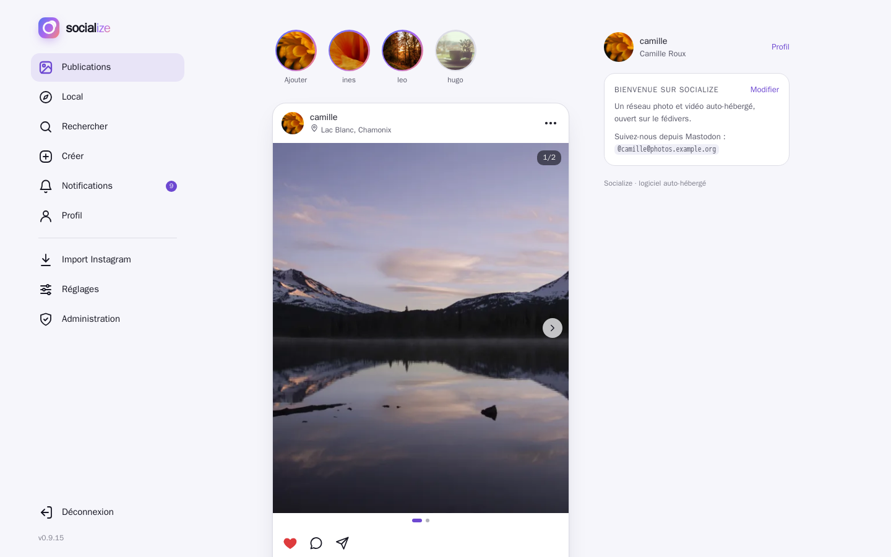
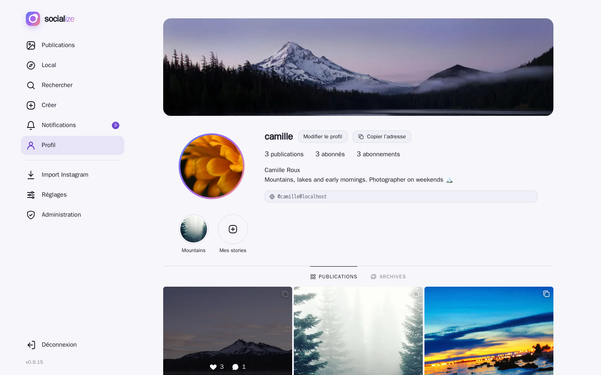
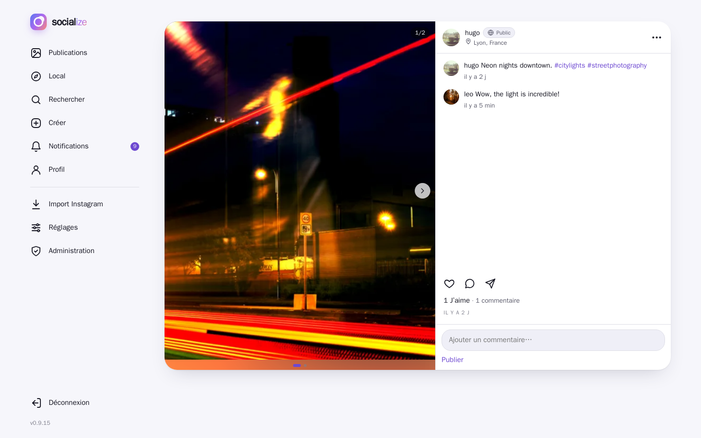
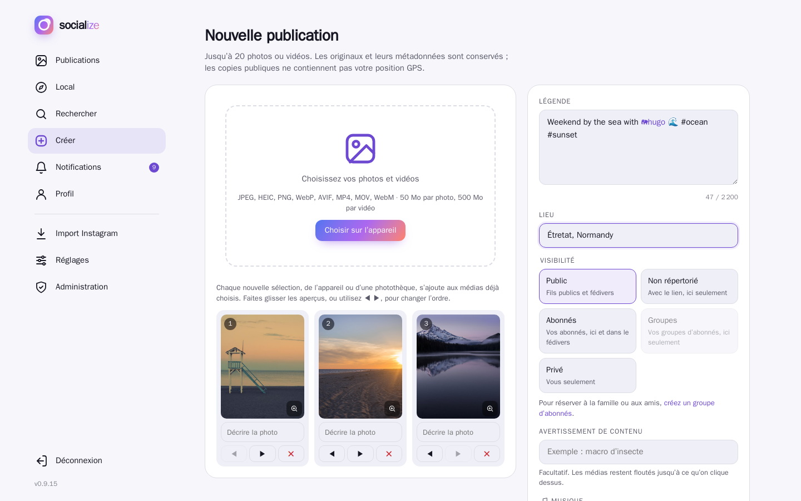
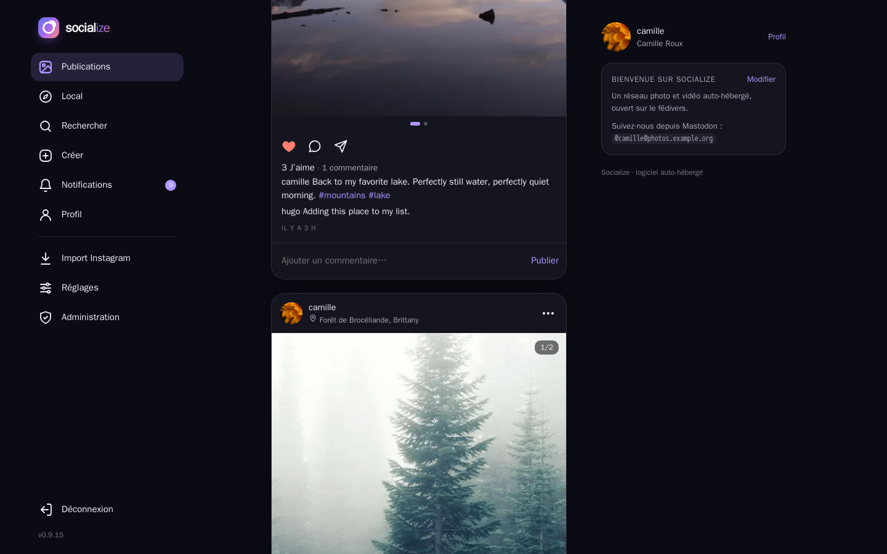
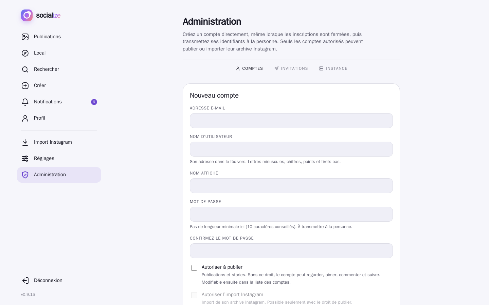
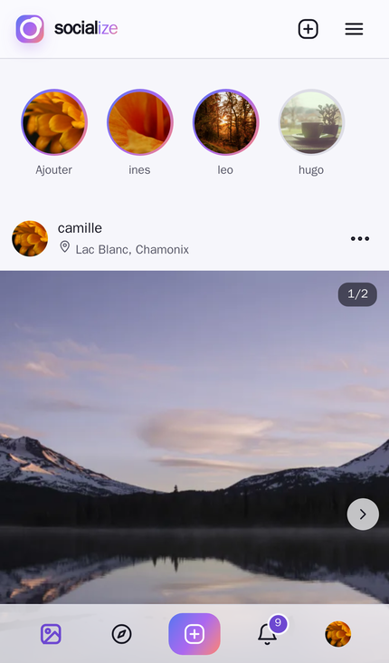
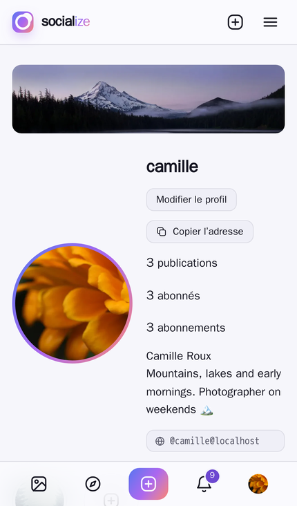

<p align="center">
  
</p>

<h1 align="center">Socialize</h1>

<p align="center">
  <strong>Un réseau social photo et vidéo auto-hébergé, ouvert sur le fédivers.</strong><br>
  Partagez photos, vidéos et stories avec les personnes de votre choix — et avec Mastodon, Pixelfed et tout le fédivers grâce à ActivityPub.
</p>

<p align="center">
  <a href="https://github.com/sadjo/socialize/actions/workflows/ci.yml"></a>
  <a href="https://github.com/sadjo/socialize/releases"></a>
  <a href="LICENSE"></a>
  
  
  
</p>

<p align="center">
  <a href="https://sadjo.github.io/socialize/">Site</a> ·
  <a href="https://github.com/sadjo/socialize/wiki/Accueil">Documentation</a> ·
  <a href="https://github.com/sadjo/socialize/wiki/Installation-fr">Installation</a> ·
  <a href="README.md">English</a>
</p>

<p align="center">
  
  <br><sub>▶ <a href="https://sadjo.github.io/socialize/#demo">Voir la vidéo de démonstration complète</a></sub>
</p>

---

## Pourquoi Socialize ?

Socialize offre l'expérience familière d'une application de partage de photos — fil, carrousels, stories, « J'aime »,
commentaires — sur un serveur qui vous appartient. Vos originaux restent chez vous, vous choisissez qui voit quoi, et
vos publications atteignent quand même vos proches sur Mastodon ou Pixelfed.

- **Vos souvenirs vous appartiennent.** Les originaux et leurs métadonnées restent privés ; les copies publiques n'ont ni EXIF ni GPS.
- **Votre public, votre choix.** Public, non répertorié, abonnés, privé, ou *groupes d'abonnés* (famille, amis…).
- **Toujours connecté.** Fédération ActivityPub complète, connexion avec un compte Mastodon, publication facultative sur Instagram.
- **Votre photothèque.** Import complet d'une archive Instagram, publication directe depuis Immich ou Synology Photos.
- **Simple à héberger.** Une seule image Docker, SQLite ou MariaDB, HTTPS automatique. Installation en une commande.

## Fonctionnalités

| | |
| --- | --- |
| 📸 **Publications** | Carrousels jusqu'à 20 photos et vidéos, texte alternatif, légendes avec hashtags et mentions, lieu, avertissement de contenu, cadre 4:5, visionneuse plein écran |
| ⏱️ **Stories** | Stories de 24 h avec texte superposé, stories à la une sur le profil (plusieurs stories d’un coup, couverture au choix), archives, liste des vues |
| 🌐 **Fédivers** | ActivityPub (WebFinger, NodeInfo, signatures HTTP) : suivre et être suivi depuis Mastodon, Pixelfed et les autres |
| 🐘 **Connexion Mastodon** | Utiliser Socialize avec son compte Mastodon existant, sans compte local |
| 👥 **Groupes d'abonnés** | Réserver une publication ou une story à certains groupes d'abonnés |
| 📦 **Import Instagram** | Envoi avec reprise d'une archive complète (jusqu'à 20 Go) : dates d'origine, carrousels, EXIF, stories archivées |
| 🖼️ **Photothèques** | Publication depuis [Immich](https://immich.app) ou Synology Photos, photos live comprises |
| 🎵 **Musique libre** | Musique Creative Commons d'[Openverse](https://openverse.org) sur les publications et les stories, avec crédits |
| 📤 **Crosspost** | Publication automatique sur un compte Instagram professionnel, ou partage vers Instagram depuis n'importe quel appareil |
| 🔔 **Notifications** | « J'aime », commentaires, mentions et nouvelles publications, dans l'application et en notifications Web Push |
| 🛡️ **Administration** | Invitations, création de comptes, droits de publication, bloc d'instance en Markdown |
| 🎨 **Thèmes** | Thèmes clair, sombre et automatique au choix de chacun ; installable sur l'écran d'accueil |

## Captures d'écran

<table>
  <tr>
    <td><br><sub>Fil d'accueil</sub></td>
    <td><br><sub>Profil</sub></td>
  </tr>
  <tr>
    <td><br><sub>Publication et commentaires</sub></td>
    <td><br><sub>Création d'une publication</sub></td>
  </tr>
  <tr>
    <td><br><sub>Thème sombre</sub></td>
    <td><br><sub>Administration</sub></td>
  </tr>
</table>

<p align="center">
  
  
  
</p>

## Démarrage rapide

Sur un serveur Linux avec [Docker](https://docs.docker.com/engine/install/) et un nom de domaine qui pointe vers lui :

```bash
curl -fsSL https://raw.githubusercontent.com/sadjo/socialize/main/install.sh | sh
```

Le script demande le nom de domaine et le compte administrateur, génère les secrets, démarre Socialize avec HTTPS
automatique et affiche l'adresse de l'instance. Tout est rangé dans `~/socialize`.

Options (`--help` pour la liste complète) :

```bash
curl -fsSL https://raw.githubusercontent.com/sadjo/socialize/main/install.sh | sh -s -- \
  --domain photos.example.org --db mariadb --email vous@example.org --username vous
```

À la main, Socialize tient en une seule image :

```bash
docker run -d --name socialize -p 80:80 -p 443:443 -p 443:443/udp \
  -e SERVER_NAME=photos.example.org -e DEFAULT_URI=https://photos.example.org \
  -e APP_SECRET="$(openssl rand -hex 32)" \
  -v socialize_data:/data -v socialize_media:/media \
  ghcr.io/sadjo/socialize:latest
```

Voir le [guide d'installation](https://github.com/sadjo/socialize/wiki/Installation-fr) (Docker Compose,
MariaDB, reverse proxy, mises à jour) et la page [Configuration](https://github.com/sadjo/socialize/wiki/Configuration-fr).

## Documentation

Le [wiki](https://github.com/sadjo/socialize/wiki/Accueil) couvre :

- [Installation](https://github.com/sadjo/socialize/wiki/Installation-fr) · [Configuration](https://github.com/sadjo/socialize/wiki/Configuration-fr) · [Mise à jour et sauvegarde](https://github.com/sadjo/socialize/wiki/Mise-a-jour-et-sauvegarde)
- [Guide d'utilisation](https://github.com/sadjo/socialize/wiki/Guide-d-utilisation) · [Administration](https://github.com/sadjo/socialize/wiki/Administration-fr)
- [Fédération](https://github.com/sadjo/socialize/wiki/Federation-fr) · [Connexion Mastodon](https://github.com/sadjo/socialize/wiki/Connexion-Mastodon) · [Intégrations](https://github.com/sadjo/socialize/wiki/Integrations-fr)
- [Commandes console](https://github.com/sadjo/socialize/wiki/Commandes-console) · [Développement](https://github.com/sadjo/socialize/wiki/Developpement) · [FAQ](https://github.com/sadjo/socialize/wiki/FAQ-fr)

## Technique

PHP 8.5 · Symfony 8.1 · FrankenPHP (mode worker) · Doctrine ORM (SQLite ou MariaDB/MySQL) · Symfony Messenger et
Scheduler · Twig, Turbo, Stimulus et Live Components · libvips et ffmpeg pour les médias.

Le code est découpé en modules (`Core`, `Media`, `Federation`, `Import`, `Crosspost`, `Integration`, `Web`, `Admin`),
chacun organisé en `Domain` / `Application` / `Infrastructure`, frontières vérifiées par Deptrac. Qualité : PHPStan au
niveau maximal, PHP-CS-Fixer, Rector et des tests qui échouent à la moindre dépréciation.

## Contribuer

Les contributions sont les bienvenues ! Lisez [CONTRIBUTING.md](CONTRIBUTING.md) et le
[code de conduite](CODE_OF_CONDUCT.md). Pour développer, Docker et `make` suffisent :

```bash
git clone https://github.com/sadjo/socialize.git && cd socialize
make up        # http://localhost:8080
make test      # PHPUnit en parallèle (ParaTest) ; make test-serie f=<filtre> pour un test précis
make quality   # PHP-CS-Fixer, Rector, PHPStan, Deptrac
```

Failles de sécurité : voir [SECURITY.md](SECURITY.md).

## Licence

Socialize est un logiciel libre publié sous la [licence publique générale GNU Affero v3.0](LICENSE).
Si vous faites tourner une version modifiée de Socialize sur un serveur, vous devez en fournir le code source à ses
utilisateurs.
