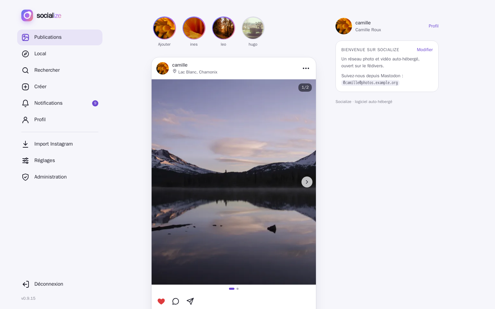
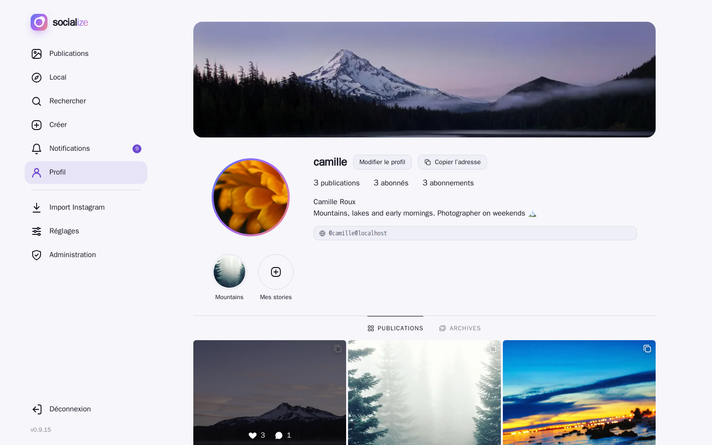
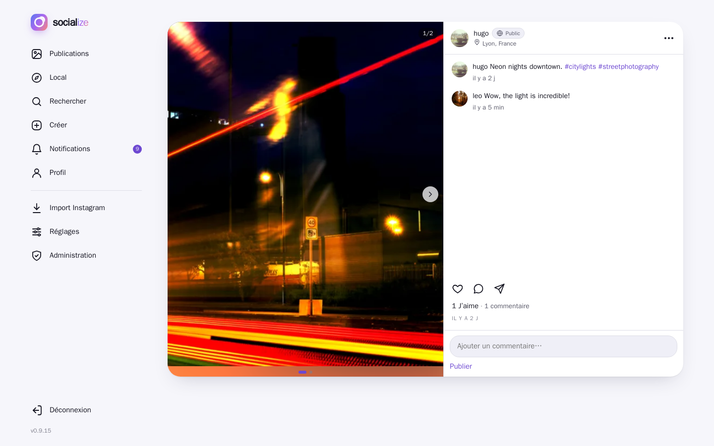
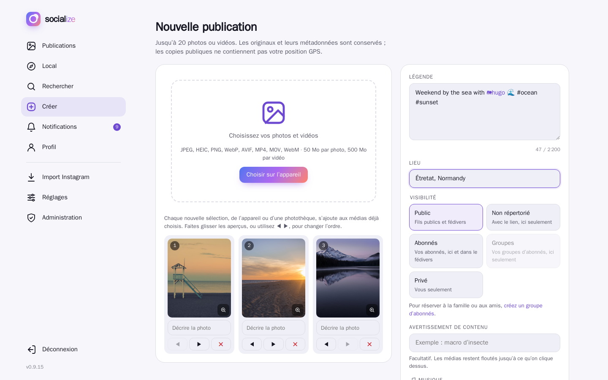
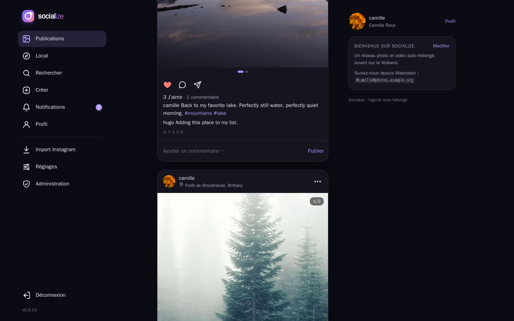
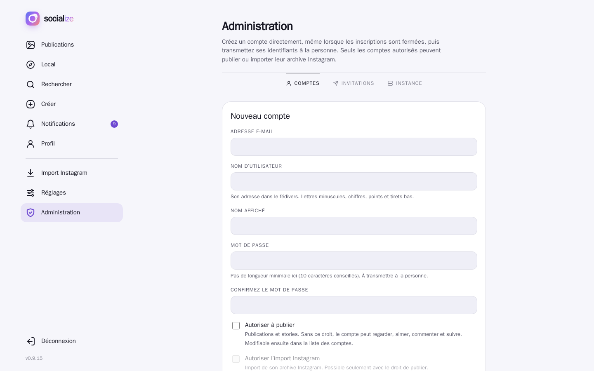
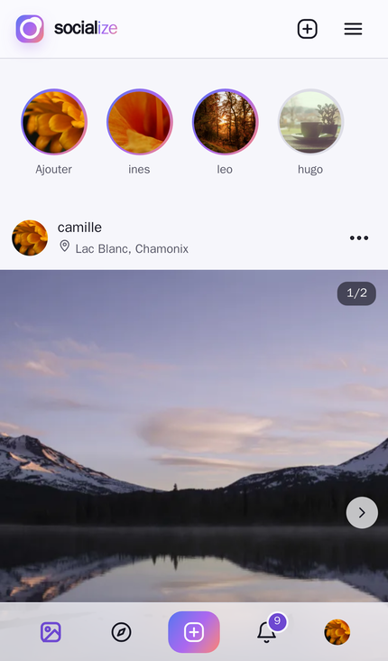
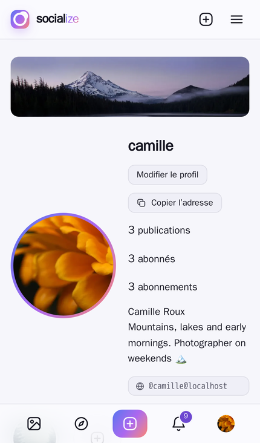

<p align="center">
  
</p>

<h1 align="center">Socialize</h1>

<p align="center">
  <strong>A self-hosted photo and video social network that speaks the fediverse.</strong><br>
  Share photos, videos and stories with the people you choose — and with Mastodon, Pixelfed and the rest of the fediverse through ActivityPub.
</p>

<p align="center">
  <a href="https://github.com/sadjo/socialize/actions/workflows/ci.yml"></a>
  <a href="https://github.com/sadjo/socialize/releases"></a>
  <a href="LICENSE"></a>
  
  
  
</p>

<p align="center">
  <a href="https://sadjo.github.io/socialize/">Website</a> ·
  <a href="https://github.com/sadjo/socialize/wiki">Documentation</a> ·
  <a href="https://github.com/sadjo/socialize/wiki/Installation">Installation</a> ·
  <a href="README.fr.md">Français</a>
</p>

<p align="center">
  
  <br><sub>▶ <a href="https://sadjo.github.io/socialize/#demo">Watch the full demo video</a></sub>
</p>

---

## Why Socialize?

Socialize gives you the familiar experience of a photo-sharing app — feed, carousels, stories, likes, comments —
on a server you own. Your originals stay with you, your audience is yours to choose, and your posts can still reach
friends who live on Mastodon or Pixelfed.

- **Own your memories.** Originals and their metadata are kept privately; public copies are stripped of EXIF and GPS.
- **Choose your audience.** Public, unlisted, followers-only, private, or custom *audience groups* (family, friends…).
- **Stay connected.** Full ActivityPub federation, sign-in with a Mastodon account, and optional crossposting to Instagram.
- **Bring your library.** Import your whole Instagram archive and publish straight from Immich or Synology Photos.
- **Easy to run.** One Docker image, SQLite or MariaDB, automatic HTTPS. Installed with a single command.

## Features

| | |
| --- | --- |
| 📸 **Posts** | Carousels of up to 20 photos and videos, alt text, captions with hashtags and mentions, location, content warnings, 4:5 frame, full-screen viewer |
| ⏱️ **Stories** | 24-hour stories with text overlay, highlights on the profile (several stories at once, chosen cover), archives, viewers list |
| 🌐 **Fediverse** | ActivityPub (WebFinger, NodeInfo, HTTP Signatures): follow and be followed from Mastodon, Pixelfed and others |
| 🐘 **Mastodon sign-in** | People can use Socialize with their existing Mastodon account — no local account needed |
| 👥 **Audience groups** | Share a post or story with selected groups of followers only |
| 📦 **Instagram import** | Resumable upload of a complete archive (up to 20 GB) with original dates, carousels, EXIF and archived stories |
| 🖼️ **Photo libraries** | Publish from [Immich](https://immich.app) or Synology Photos, Live Photos included |
| 🎵 **Free music** | Add Creative Commons music from [Openverse](https://openverse.org) to posts and stories, with credits |
| 📤 **Crossposting** | Publish to an Instagram professional account automatically, or share to Instagram from any device |
| 🔔 **Notifications** | Likes, comments, mentions and new posts, in the app and as Web Push notifications on phones and desktops |
| 🛡️ **Administration** | Invitations, account creation, publishing permissions, editable instance block in Markdown |
| 🎨 **Themes** | Light, dark and automatic themes chosen by each user; installable as a home screen app |

## Screenshots

<table>
  <tr>
    <td><br><sub>Home feed</sub></td>
    <td><br><sub>Profile</sub></td>
  </tr>
  <tr>
    <td><br><sub>Post and comments</sub></td>
    <td><br><sub>Compose a post</sub></td>
  </tr>
  <tr>
    <td><br><sub>Dark theme</sub></td>
    <td><br><sub>Administration</sub></td>
  </tr>
</table>

<p align="center">
  
  
  
</p>

## Quick start

On a Linux server with [Docker](https://docs.docker.com/engine/install/) and a domain name pointing to it:

```bash
curl -fsSL https://raw.githubusercontent.com/sadjo/socialize/main/install.sh | sh
```

The installer asks for your domain name and administrator account, generates the secrets, starts Socialize with
automatic HTTPS and prints the address of your instance. Everything is stored in `~/socialize`.

Options (`--help` for the full list):

```bash
curl -fsSL https://raw.githubusercontent.com/sadjo/socialize/main/install.sh | sh -s -- \
  --domain photos.example.org --db mariadb --email you@example.org --username you
```

Prefer to do it by hand? Socialize is a single image:

```bash
docker run -d --name socialize -p 80:80 -p 443:443 -p 443:443/udp \
  -e SERVER_NAME=photos.example.org -e DEFAULT_URI=https://photos.example.org \
  -e APP_SECRET="$(openssl rand -hex 32)" \
  -v socialize_data:/data -v socialize_media:/media \
  ghcr.io/sadjo/socialize:latest
```

See the [Installation guide](https://github.com/sadjo/socialize/wiki/Installation) for Docker Compose,
MariaDB, reverse proxies and upgrades, and [Configuration](https://github.com/sadjo/socialize/wiki/Configuration)
for every setting.

## Documentation

The [wiki](https://github.com/sadjo/socialize/wiki) covers:

- [Installation](https://github.com/sadjo/socialize/wiki/Installation) · [Configuration](https://github.com/sadjo/socialize/wiki/Configuration) · [Upgrade and backup](https://github.com/sadjo/socialize/wiki/Upgrade-and-Backup)
- [User guide](https://github.com/sadjo/socialize/wiki/User-Guide) · [Administration](https://github.com/sadjo/socialize/wiki/Administration)
- [Federation](https://github.com/sadjo/socialize/wiki/Federation) · [Mastodon sign-in](https://github.com/sadjo/socialize/wiki/Mastodon-Sign-In) · [Integrations](https://github.com/sadjo/socialize/wiki/Integrations)
- [Console commands](https://github.com/sadjo/socialize/wiki/Console-Commands) · [Development](https://github.com/sadjo/socialize/wiki/Development) · [FAQ](https://github.com/sadjo/socialize/wiki/FAQ)

The documentation is also available [in French](https://github.com/sadjo/socialize/wiki/Accueil).

## Tech stack

PHP 8.5 · Symfony 8.1 · FrankenPHP (worker mode) · Doctrine ORM (SQLite or MariaDB/MySQL) · Symfony Messenger and
Scheduler · Twig, Turbo, Stimulus and Live Components · libvips and ffmpeg for media.

The code is split into modules (`Core`, `Media`, `Federation`, `Import`, `Crosspost`, `Integration`, `Web`, `Admin`),
each following a `Domain` / `Application` / `Infrastructure` layout whose boundaries are enforced by Deptrac.
Quality gates: PHPStan at the maximum level, PHP-CS-Fixer, Rector and a test suite that fails on any deprecation.

## Contributing

Contributions are welcome! Please read [CONTRIBUTING.md](CONTRIBUTING.md) and our
[Code of Conduct](CODE_OF_CONDUCT.md). For a local development environment you only need Docker and `make`:

```bash
git clone https://github.com/sadjo/socialize.git && cd socialize
make up        # http://localhost:8080
make test      # PHPUnit
make quality   # PHP-CS-Fixer, Rector, PHPStan, Deptrac
```

Security issues: see [SECURITY.md](SECURITY.md).

## License

Socialize is free software released under the [GNU Affero General Public License v3.0](LICENSE).
If you run a modified version of Socialize on a server, you must make its source code available to its users.
